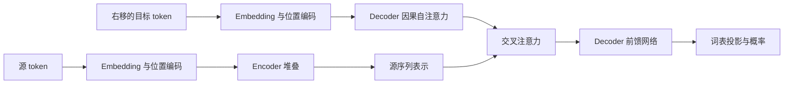

# 《Attention Is All You Need》前四页解析

日期：2026-11-27。依据：[本地 arXiv v7 PDF](../papers/attention-is-all-you-need.pdf) 的第 1～4 页，包括摘要、§1～§3.2.1，以及 §3.2.2 的开头。已对照第 3 页原图检查架构连接。

下面按“原文论点 → 如何理解 → 对架构的影响”分析，教学示例与推导用于帮助理解，不是论文中的实验。此笔记由助手整理，阅读和练习验收仍需学习者完成。

## 先抓住前四页的主线

论文希望在保持序列建模能力的同时，减少沿序列位置逐步计算的依赖，并缩短远距离位置之间的信息传递路径。方法是在 Encoder–Decoder 框架中，用注意力承担位置之间的信息交互，再结合逐位置前馈网络等模块形成完整模型。

这篇论文没有首次发明注意力或自注意力。§1～§2 明确承认已有相关工作；核心贡献在于提出、组合并验证这一完整架构。

| 页码 | 主要内容 | 要带走的问题 |
| --- | --- | --- |
| 1 | 摘要：提出架构和实验结果 | 解决什么问题，以什么证据支持？ |
| 2 | Introduction、Background、总体架构 | 旧模型的计算依赖在哪里，新模型改变什么？ |
| 3 | Figure 1、Encoder / Decoder 堆叠 | 信息从输入到输出经过哪些模块？ |
| 4 | 注意力公式、多头注意力开头 | 位置之间的信息如何通过矩阵运算汇总？ |

## 第 1 页：怎样读摘要

### 原文的三个论点

1. 当时主流序列转换模型使用循环或卷积网络，并采用 Encoder–Decoder 结构；优秀模型通常还在两者之间加入注意力。
2. Transformer 移除用于序列建模的循环与卷积，以注意力为主要的信息交互方式，提升可并行性。
3. 翻译与句法分析实验支持其效果。摘要报告英德翻译 28.4 BLEU，以及英法翻译 41.8 BLEU、8 张 GPU 训练 3.5 天等结果。

这些数值是作者在特定任务与配置下报告的结果。BLEU 衡量生成译文与参考译文之间的匹配程度，不是“翻译正确率百分比”。实验配置与比较方法需在 §5～§6 进一步核对。

### 怎样理解标题

“Attention Is All You Need”强调用注意力取代序列建模中的循环与卷积依赖。Figure 1 同时包含 embedding、位置编码、FFN、残差连接、LayerNorm 和输出层，因此不能把它理解成“整个网络只有 attention”。

## 第 2 页：为什么要改变序列计算方式

### 1. RNN 的关键限制是计算依赖链

§1 描述循环模型的隐藏状态依赖上一时刻。用教学表达式表示：

\[
h_t=f(h_{t-1},x_t)
\]

这意味着计算第 3 个位置的隐藏状态，通常必须先得到第 2 个位置的隐藏状态。即使模型中的矩阵运算能在 GPU 上并行，不同位置之间仍有这条依赖链。论文主要讨论的是一条训练样本内部沿序列维度的并行性。

Transformer 在一层中把各位置组织为矩阵，批量计算位置之间的关联和输出。层与层之间仍然有先后依赖，但不再要求像 RNN 那样在每层沿位置逐个递推。

### 2. 远距离交互需要多少次传递

§2 将 Transformer 与循环 / 卷积方案进行比较。相隔很远的两个位置在 RNN 中需要跨过多个状态，在局部卷积中通常需要多层传播；全局自注意力允许它们在同一层直接建立联系。

“常数长度的信息路径”说的是网络图中连接两个位置的路径，并不代表运行时间或计算量为常数。标准密集自注意力要处理大量位置对，注意力核心计算随序列长度呈平方增长；第 6 页的 Table 1 会进一步讨论。

### 3. 这里的 self-attention 是什么意思

同一个序列的各位置互相参与表示更新。例如，一句话中的某个位置根据其他位置提供的信息，形成新的上下文表示。

它汇总的是向量信息，并不天然带有“主语”“宾语”等标签。注意力分布可以帮助观察模型行为，但单个头的权重不能直接视为完整的语义解释。

### 4. 原版模型仍采用 Encoder–Decoder

§3 将源序列映射为连续表示序列：

\[
(x_1,\ldots,x_S)\longrightarrow(z_1,\ldots,z_S)
\]

Encoder 输出保留多个位置，通常不是把整句话压缩成一个向量。Decoder 在这些表示的条件下逐步生成目标序列：

\[
p(y_1,\ldots,y_T\mid x)
=\prod_{t=1}^{T}p(y_t\mid y_{<t},x)
\]

上式是对原文“auto-regressive”的教学展开：下一 token 的概率依赖源序列和已经生成的目标前缀。

## 第 3 页：读懂 Figure 1

### 先沿两条路径读图

源语言路径：

```text
源 token → Input Embedding + Positional Encoding
        → Encoder 的 N 层 → 源序列表示
```

目标语言路径：

```text
右移的目标 token → Output Embedding + Positional Encoding
               → Decoder 的 N 层 → Linear → Softmax → token 概率
```

Encoder 的最终输出连接到每个 Decoder Layer 中间的注意力子层。下面是重画的简化信息流，Add & Norm 与层堆叠细节仍以原论文 Figure 1 为准。



### Encoder Layer 的两种子层

1. **多头自注意力**：让源序列位置交换信息。
2. **逐位置前馈网络**：对每个位置的向量做非线性变换。

每个子层外都有残差连接与 LayerNorm。§3.1 给出的表达式为：

\[
\operatorname{LayerNorm}\bigl(x+\operatorname{Sublayer}(x)\bigr)
\]

这里归一化位于残差相加之后，属于 Post-LN。后文 §5.4 还会补充 dropout 的位置。

注意力负责跨位置交互；FFN 的计算分别作用于各位置。FFN 内部可以先扩展维度再投影回来，残差相加处的输入输出维度必须匹配。

### Decoder Layer 的三种子层

1. **Masked self-attention**：读取允许访问的目标前缀。
2. **Encoder–Decoder attention**：利用源序列表示，通常称为 cross-attention。
3. **逐位置前馈网络**：继续变换目标位置的表示。

同样，每个子层都有 Add & Norm。交叉注意力的 Q 来自 Decoder，K/V 来自 Encoder 输出；这个来源关系在第 5 页 §3.2.3 会明确说明。

### N=6 和 d_model=512 分别表示什么

§3.1 中 Encoder 和 Decoder 各堆叠 6 层，隐藏表示维度为 512。“identical layers”表示层结构相同，通常各层参数独立，不能据此推断权重共享。

### 右移输入与 mask 必须一起理解

以目标 token `我 爱 你 EOS` 为例：

| 位置 | 1 | 2 | 3 | 4 |
| --- | --- | --- | --- | --- |
| Decoder 输入 | BOS | 我 | 爱 | 你 |
| 当前位置监督目标 | 我 | 爱 | 你 | EOS |
| 该位置可见的目标输入 | BOS | BOS、我 | BOS、我、爱 | BOS、我、爱、你 |

- **右移**让当前位置输入不包含当前位置要预测的答案。
- **因果 mask**阻止这个答案从更后面的输入位置泄漏过来。

mask 通常允许读取对角线上的“当前输入位置”。由于输入已经右移，它对应的是前一个目标 token，因此不违反自回归约束。

训练时已有完整目标序列，可以将右移输入一次送入模型，同时计算各位置损失；生成时尚不知道未来 token，通常只能逐个生成。这解释了“更容易并行训练”和“仍然自回归生成”为何可以同时成立。

## 第 4 页：把公式 (1) 拆成计算步骤

\[
\operatorname{Attention}(Q,K,V)
=\operatorname{softmax}\left(\frac{QK^\top}{\sqrt{d_k}}\right)V
\]

对于一个 query，它先与各 key 计算匹配分数，再把分数转成权重，最后按这些权重汇总各 value。Q/K 用于匹配，V 是被汇总的信息。

### 1. 输入投影与形状

用一个自注意力头作为教学例子，忽略批维度：

\[
Q=XW_Q,\qquad K=XW_K,\qquad V=XW_V
\]

第 4 页 §3.2.2 开始介绍可学习的线性投影。单头的注意力函数本身接收 Q/K/V，不负责指定它们一定来自哪个输入；交叉注意力就使用不同来源。

| 对象 / 操作 | 形状 | 含义 |
| --- | --- | --- |
| X | `[T, D]` | 输入各位置的表示 |
| W_Q、W_K | `[D, d_k]` | 产生匹配向量的参数 |
| W_V | `[D, d_v]` | 产生 value 的参数 |
| Q、K | `[T, d_k]` | 各位置的 query / key |
| V | `[T, d_v]` | 各位置待汇总的信息 |
| QKᵀ | `[T, T]` | 每个 query 对各 key 的分数 |
| softmax 后的权重 | `[T, T]` | 每行沿 key 位置归一化 |
| 权重乘 V | `[T, d_v]` | 每个位置汇总后的表示 |

### 2. 为什么除以 √d_k

脚注 4 的教学假设是 q、k 各分量独立、零均值、单位方差。在此假设下：

\[
\operatorname{Var}(q\cdot k)=d_k
\]

点积分数的典型尺度随维度增大。较大的分数容易使 softmax 权重过度集中，其梯度可能很小；除以 √d_k 控制分数尺度，有助于训练。这个推导依赖上述假设，不是对所有实际向量分布的无条件结论。

### 3. 一个可以手算的例子

取 `q=[1,0]`，两条 key 为 `[1,0]`、`[0,1]`，两条 value 为 `[10,0]`、`[0,20]`。

```text
点积分数：          [1, 0]
除以 √2：          [0.7071, 0]
softmax 权重：     约 [0.6698, 0.3302]
加权汇总 value：  约 [6.698, 6.605]
```

输出是两条 value 的加权和，而不是简单选出分数最高的一条。实际模型通过学习投影参数，形成适合任务的信息表示。

### 4. Figure 2 中 mask 的作用

Decoder 中的 mask 放在 softmax 之前，屏蔽的分数设为负无穷或实现中合适的极小值，使对应权重接近零。它改变可读取的信息范围，不改变注意力“算分数 → 得权重 → 汇总 V”的基本过程。

### 5. 多头注意力在这一页只展开了开头

§3.2.2 提出将输入通过多组不同的可学习投影，分别进行注意力计算。不同头可在不同表示子空间里学习关联。完整的拼接、输出投影、参数形状与 8 头配置在第 5 页继续说明，下一次阅读应从这里衔接。

## 读完这四页，应能解释的五件事

1. 新架构改变的是哪些计算依赖，以及为什么有利于训练并行。
2. 原版 Transformer 的 Encoder 与 Decoder 分别接收和输出什么。
3. Decoder 为什么需要目标前缀和源序列两种信息。
4. 右移输入与因果 mask 怎样防止答案泄漏。
5. 注意力怎样从 Q/K 的匹配，得到对 V 的加权汇总。

建议下一次先继续读第 5 页 §3.2.2～§3.2.3，完成多头注意力与三种使用方式的闭环，再读 FFN 与 embedding。结合[学习计划](../learning-plan.md)，动手练习前先手算上面的单 query 示例。
